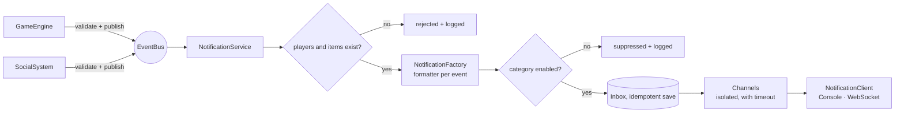

# Globalli Notifications

A real-time, in-app notification system for an online multiplayer
gaming platform. Game and social subsystems emit events. The system
validates them, turns them into player notifications, applies each
player's category preferences, stores them in a bounded inbox and
hands them to the game client's delivery mechanism.

Built for the Globalli "Real-Time Notification System" coding
challenge in TypeScript on Node.js.

**What is the deliverable, and what is a demo harness:**

- **Core (the challenge):** `src/domain`, `src/notifications`,
  `src/preferences`, `src/events`, `src/producers`, `src/channels`,
  `src/clients` and `src/composition.ts`. Run it with `npm run demo`.
- **Demo harness (optional extra):** `src/server` and `public/`. An
  HTTP + WebSocket server and a one-page client that make real-time
  delivery visible. It was added after the core was complete, as the
  brief allows. The brief puts client display out of scope, so nothing
  in the core depends on the harness, and it can be deleted without
  touching the core.

---

## Quick start

Requires **Node.js 20.19+ or 22.12+** (the test toolchain needs it;
`.nvmrc` pins 22).

```bash
git clone https://github.com/HasnatHassan/globalliNotifications.git
cd globalliNotifications
npm install
npm test          # unit + integration tests
npm run demo      # builds, then runs the CLI walkthrough of the brief's example triggers (the core)
npm start         # builds, then serves the demo harness → http://localhost:3000  (PORT=xxxx to change)
```

`npm run demo` and `npm start` always rebuild first, so they never run
stale compiled code. `npm run build` on its own compiles to `dist/`.

`npm run dev` runs the server from source with reload.
`ACTIVITY_FEED=off npm start` disables the operator activity feed.

### What `npm run demo` shows

```
▶ gameEngine.playerLeveledUp(1, 15)  // User 1 leveled up to 15
  📨 → Alice (#1) [GAME/LEVEL_UP] Congratulations! You've reached level 15!

▶ gameEngine.itemAcquired(2, "SwordOfAzeroth")  // User 2 acquired an item
  📨 → Bob (#2) [GAME/ITEM_ACQUIRED] You've acquired the legendary Sword of Azeroth!

▶ socialSystem.friendRequestSent(3, 1)  // User 3 sent a friend request to user 1
  📨 → Alice (#1) [SOCIAL/FRIEND_REQUEST] Player 'Cara' has sent you a friend request.

▶ socialSystem.friendRequestAccepted(1, 3)  // User 1 accepted friend request from 3
  📨 → Cara (#3) [SOCIAL/FRIEND_ACCEPTED] Player 'Alice' accepted your friend request.
...
▶ gameEngine.playerLeveledUp(1, -5)  // invalid level
  ⛔ rejected by producer: Invalid event: newLevel Number must be greater than or equal to 1

▶ socialSystem.friendRequestSent(77, 1)  // player 77 does not exist
  ⛔ rejected by producer: Invalid event: unknown player id(s) 77

▶ gameEngine.itemAcquired(2, "SwordOfAzerot")  // typo: unknown item
  ⛔ rejected by producer: Invalid event: unknown item id(s) SwordOfAzerot
...
▶ socialSystem.friendRequestSent(4, 1)  // social → suppressed
  🔕 suppressed for Alice (#1): SOCIAL notifications disabled
```

The demo also covers challenge completion, PvP, a new follower, a
common item that is deliberately not notified, and Alice's inbox.

### Demo harness (`npm start`)

Open http://localhost:3000. The page shows two players side by side
(Alice and Cara by default), each with its own WebSocket.

- **Run brief examples** fires the four triggers from the brief.
  **Fire event** sends any of the 8 event types.
- The **Game / Social** toggles change that player's preferences.
- **Read / unread:** click a notification, use its toggle, or use
  **Mark all read**. Read state is stored on the server and synced
  across a player's connections.
- **System activity** shows what each event produced (sent, offline,
  suppressed, undelivered, failed). It comes from a separate
  operator socket (`/ws/activity`), never from player sockets.

Seed data: players `1 Alice`, `2 Bob`, `3 Cara`, `4 Dan`. Items
`SwordOfAzeroth` (legendary), `DragonscaleShield` (epic),
`EmberAmulet` (rare), `IronDagger` and `HealthPotion` (common).

---

## Architecture



1. **Producers** (`GameEngine`, `SocialSystem`) expose the brief's
   methods. They validate the payload's shape and check that every
   referenced player and item exists, then stamp an event id and time
   and publish. Any invalid call throws synchronously
   (`InvalidEventError` / `UnknownReferenceError`) and nothing is
   published.
2. **EventBus.** `publish` resolves when the event is *accepted*, not
   when it has been handled. That is the contract a broker can honour.
   The in-memory bus dispatches in order on a queue.
3. **NotificationService** re-applies the reference check to anything
   arriving on the bus. It then builds the notifications. Each one,
   in isolation from the others:
   - is checked against the player's preferences,
   - is saved to the inbox (idempotent by an id derived from the
     event id),
   - is sent to every channel, with failures isolated and a timeout
     on each send.

   It ends up *sent* (delivered to a live client), *offline* (stored
   for replay), *undelivered* (all channels failed), *suppressed*,
   *duplicate* or *failed*.
4. **Formatters** (one file per event type, in a typed registry)
   decide recipient, category and wording.
5. **Ports** (`PreferenceStore`, `NotificationRepository`) are async,
   so a database adapter implements the same interface.

```
src/
  domain/          events, event schemas (validation + player refs), Notification, categories
  catalog/         PlayerLookup / ItemLookup ports + seed data
  preferences/     PreferenceStore port + in-memory map
  notifications/   formatters/ (one per event), factory, service, inbox repository
  channels/        NotificationChannel port, InAppChannel
  clients/         NotificationClient port, Console / WebSocket / Recording clients
  events/          EventBus port + in-memory queue
  producers/       GameEngine, SocialSystem (simulated platform)
  composition.ts   core composition root (manual DI)
  demo.ts          CLI composition root + walkthrough
  server/          demo harness: HTTP routes, WebSocket hub, activity feed, server root
public/index.html  demo page (no build step)
tests/             Vitest suites
context/           spec files the work was driven from
```

### Harness API

| Method & path                                    | Purpose                                                       |
| ------------------------------------------------ | ------------------------------------------------------------- |
| `GET /api/players` · `GET /api/items`            | Seed data                                                     |
| `GET` / `PUT /api/players/:id/preferences`       | Read / partially update, e.g. `{ "SOCIAL": false }`           |
| `GET /api/players/:id/notifications`             | Inbox, newest first                                           |
| `PATCH /api/players/:id/notifications/:nid`      | `{ "read": true }` or `{ "read": false }`                     |
| `POST /api/players/:id/notifications/read-all`   | Mark the whole inbox read                                     |
| `POST /api/events`                               | Simulate an event through the producers; `202 Accepted`, 400 malformed, 404 unknown player/item |
| `WS /ws?userId=1`                                | `welcome` (inbox + unread count), `notification`, `read-state` |
| `WS /ws/activity`                                | Operator feed of dispatch outcomes (disable with `ACTIVITY_FEED=off`) |

Responses use `{ data }` on success and `{ error: { message, details? } }`
on failure (400 invalid input, 404 unknown player or notification,
413 body over 10 kB). WebSocket upgrades from another browser origin
are refused with 403.

---

## Assumptions and limits

- The brief says a `Notification` class is *provided*, but none was
  attached. [`src/domain/Notification.ts`](src/domain/Notification.ts)
  defines one as an immutable value object.
- "Rare or valuable" items are those with rarity `rare`, `epic` or
  `legendary`. Common items are not notified. Unknown item ids are
  rejected as invalid input.
- Every category is enabled until the player turns it off.
- `playerLeveledUp(1, 15)` is trusted to be a new level: the game
  engine owns level state, so a repeated or lower level is not
  detected here.
- Producer methods throw synchronously on invalid input (bad shape,
  unknown player or item), so fire-and-forget calls in the brief's
  style fail loudly at the call site and never cause an unhandled
  rejection.
- `friendRequestAccepted(1, 3)` means *1 accepted 3's request*, so
  **3** is notified. The notification layer trusts the social
  system's events; it doesn't check that a request was sent. PvP
  notifies the victim or loser. Self-targeted social and PvP events
  produce nothing.
- The inbox keeps the **latest 100** notifications per player. Older
  ones are dropped, read or not. Replay on connect and the unread
  count cover exactly that window. Duplicate detection remembers the
  last 10,000 notification ids.
- No authentication. The harness trusts `userId` on connect, which is
  acceptable for a local demo only.

See [`docs/DESIGN.md`](docs/DESIGN.md) for design rationale and
tradeoffs, [`docs/AI_USAGE.md`](docs/AI_USAGE.md) for how AI was
used, and [`context/`](context/) for the specs.
