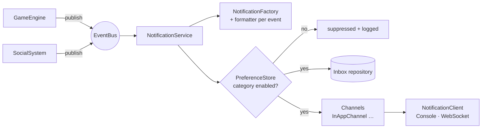

# Globalli Notifications

A real-time, in-app notification system for an online multiplayer
gaming platform. Game and social subsystems emit events, and the
system turns them into player notifications, applies each player's
category preferences, stores them in an inbox and pushes them to
connected game clients over WebSocket.

Built for the Globalli "Real-Time Notification System" coding
challenge in TypeScript on Node.js.

---

## Quick start

```bash
git clone https://github.com/HasnatHassan/globalliNotifications.git
cd globalliNotifications
```

Requires **Node.js 20+** (developed on Node 25; `.nvmrc` pins 22).

```bash
npm install
npm run build
npm test          # 32 unit + integration tests
npm run demo      # CLI walkthrough of the brief's example triggers
npm start         # live demo → http://localhost:3000  (PORT=xxxx to change)
```

During development, `npm run dev` runs the server from source with
reload (tsx).

### What `npm run demo` shows

```
▶ gameEngine.playerLeveledUp(1, 15)  // User 1 leveled up to 15
  📨 → Alice (#1) [GAME/LEVEL_UP] Congratulations! You've reached level 15!

▶ gameEngine.itemAcquired(2, "SwordOfAzeroth")  // User 2 acquired an item
  📨 → Bob (#2) [GAME/ITEM_ACQUIRED] You've acquired the legendary Sword of Azeroth!

▶ socialSystem.friendRequestSent(3, 1)  // User 3 sent a friend request to user 1
  📨 → Alice (#1) [SOCIAL/FRIEND_REQUEST] Player 'Cara' has sent you a friend request.

▶ socialSystem.friendRequestAccepted(1, 3)  // User 1 accepted friend request from 3
  📨 → Cara (#3) [SOCIAL/FRIEND_ACCEPTED] Player 'Alice' accepted your friend request.
...
▶ socialSystem.friendRequestSent(4, 1)  // social → suppressed
  🔕 suppressed for Alice (#1): SOCIAL notifications disabled
```

The demo continues with challenge completion, PvP, a new follower,
a common item that is deliberately not notified, a preference
change, and Alice's inbox.

### Live demo (`npm start`)

Open http://localhost:3000. The page shows two players side by side
(Alice and Cara by default), each connected over its own WebSocket.

- **Run brief examples** fires the four triggers from the brief. The
  friend request from Cara appears live in Alice's feed.
- **Fire event** sends any of the 8 event types with chosen players
  or items.
- The **Game / Social** toggles change that player's preferences.
  Turn Social off for Alice and send another friend request: the
  activity log shows it as *suppressed*, and nothing reaches her feed.
- **Reload** the page: each feed is rebuilt from the player's inbox.
  Notifications sent while a player was offline are not lost.

Seed data: players `1 Alice`, `2 Bob`, `3 Cara`, `4 Dan`. Items
`SwordOfAzeroth` (legendary), `DragonscaleShield` (epic),
`EmberAmulet` (rare), `IronDagger` and `HealthPotion` (common).

---

## Features

| Area                | What's included                                                                                         |
| ------------------- | ------------------------------------------------------------------------------------------------------- |
| In-game events      | Level up · Item acquired (rare+ only) · Challenge completed · PvP attacked · PvP defeated               |
| Social events       | Friend request · Friend request accepted · New follower                                                 |
| Preferences         | Per player, per category (`GAME`, `SOCIAL`) on/off map, opted in by default                             |
| Real-time delivery  | WebSocket push to every open connection of the recipient (multi-tab/device)                             |
| Inbox               | Per-player history (capped), replayed on connect, mark-as-read endpoint                                 |
| Robustness          | One failing channel/handler never blocks others; dead sockets are dropped by heartbeat                  |
| Input validation    | zod schemas on every HTTP body/param and the WS `userId`                                                 |
| Tests               | Formatters, preferences, service gating and error isolation, event bus, end to end, HTTP + WS           |

---

## Architecture



1. **Producers** (`GameEngine`, `SocialSystem`) expose the brief's
   methods and only publish typed domain events. They have no
   dependency on the notification code.
2. **EventBus** (in-process, typed pub/sub) decouples producers from
   consumers.
3. **NotificationService** runs the pipeline and is generic over
   event types.
4. **Formatters** (Strategy, one per event type, held in a typed
   registry) decide the *recipient*, *category*, and *wording*, or
   return nothing (a common item, or a player targeting themselves).
5. **PreferenceStore** gates by category *before* anything is stored
   or sent.
6. **Channels → Client.** The in-app channel hands off to a
   `NotificationClient`, the external delivery mechanism the brief
   says to mock: console for the CLI, WebSocket for the server.

All concrete classes are wired in one place,
[`src/composition.ts`](src/composition.ts).

```
src/
  domain/          Notification class, categories, DomainEvent union
  catalog/         PlayerDirectory, ItemCatalog (names, rarity)
  preferences/     PreferenceStore port + in-memory map
  notifications/   formatters/, NotificationFactory, NotificationService, repository
  channels/        NotificationChannel port, InAppChannel
  clients/         NotificationClient port, Console / WebSocket / Recording clients
  events/          EventBus port + in-memory implementation
  producers/       GameEngine, SocialSystem (simulated)
  server/          Express routes, WebSocket hub, zod schemas
  composition.ts   wiring (manual DI)
  demo.ts          CLI walkthrough
public/index.html  live demo page (no build step)
tests/             Vitest suites
context/           spec files the AI worked from (see docs/AI_USAGE.md)
```

### HTTP / WebSocket API (demo layer)

| Method & path                                       | Purpose                                            |
| --------------------------------------------------- | -------------------------------------------------- |
| `GET /api/players` · `GET /api/items`               | Seed data                                          |
| `GET /api/players/:id/preferences`                  | Category preferences                               |
| `PUT /api/players/:id/preferences`                  | Partial update, e.g. `{ "SOCIAL": false }`         |
| `GET /api/players/:id/notifications`                | Inbox, newest first                                |
| `POST /api/players/:id/notifications/:nid/read`     | Mark as read                                       |
| `POST /api/events`                                  | Simulate an event, e.g. `{ "type": "PLAYER_LEVELED_UP", "playerId": 1, "newLevel": 15 }` |
| `WS /ws?userId=1`                                   | Receives `welcome` (inbox), `notification`, `activity` messages |

Responses use `{ data }` on success and `{ error: { message, details? } }`
on failure.

---

## Assumptions

- The brief says a `Notification` class is *provided*, but none was
  attached. [`src/domain/Notification.ts`](src/domain/Notification.ts)
  defines one with the fields the brief implies.
- "Rare or valuable" items are those with rarity `rare`, `epic` or
  `legendary`. Common and unknown items are not notified.
- Players with no saved preferences receive every category.
- `friendRequestAccepted(1, 3)` means *1 accepted 3's request*, so
  **3** is notified. PvP notifies the victim or loser.
- There is no authentication (out of scope). The WebSocket trusts
  `userId` for the demo only.

---

## Further reading

- [`docs/DESIGN.md`](docs/DESIGN.md): patterns, tradeoffs, how to
  extend (push/email, per-type preferences, scaling out, quiet
  hours, digests) and likely interview questions.
- [`docs/AI_USAGE.md`](docs/AI_USAGE.md): how AI was used. Covers
  prompts, the spec-driven workflow, tools, and what was reviewed
  or changed by hand.
- [`context/`](context/): the six spec files that drove
  implementation, plus [`CLAUDE.md`](CLAUDE.md).

---

Author: Hasnat Hassan · [github.com/HasnatHassan](https://github.com/HasnatHassan)
